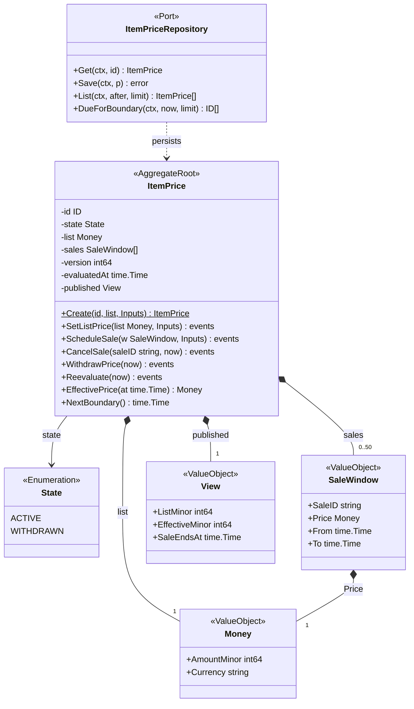
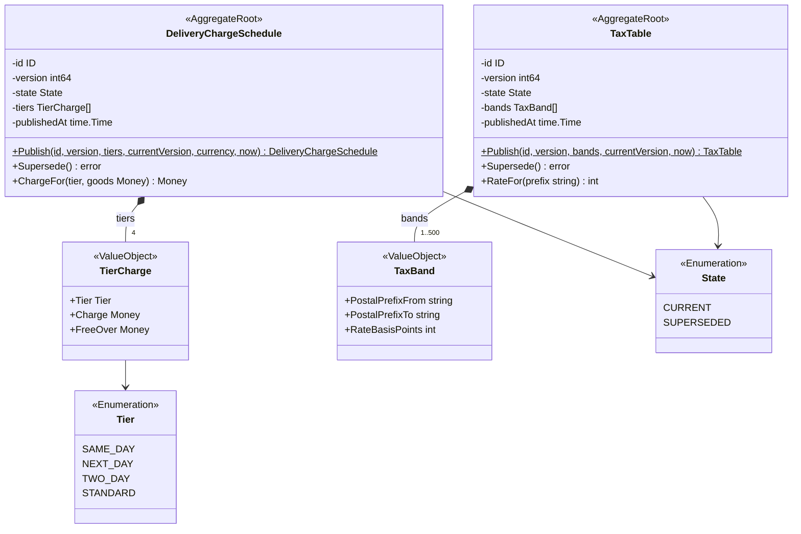
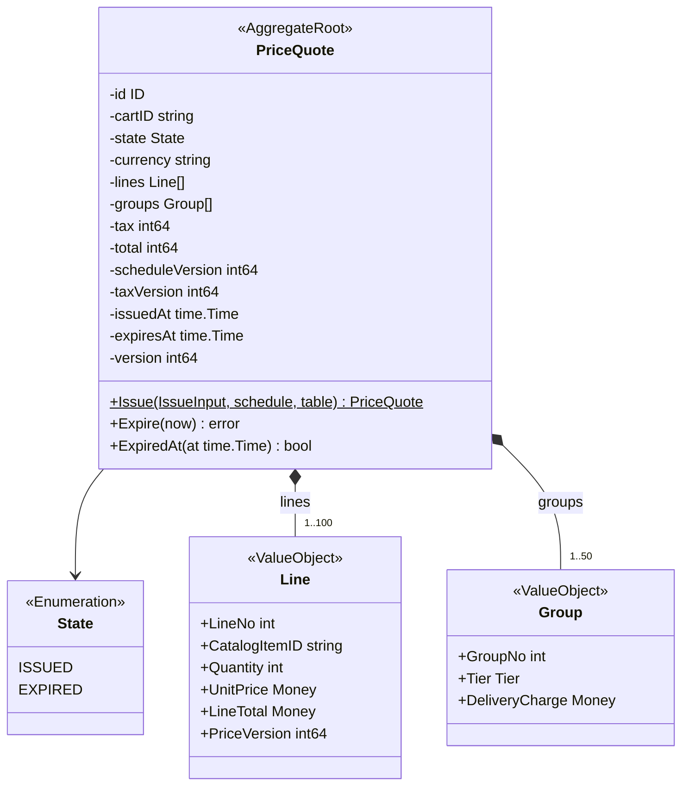
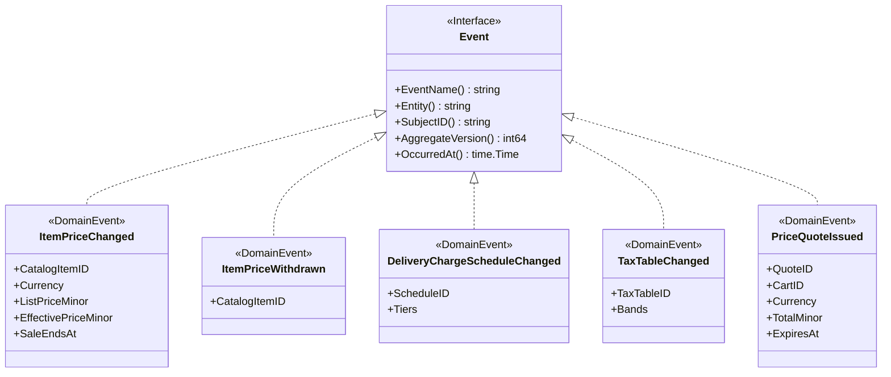
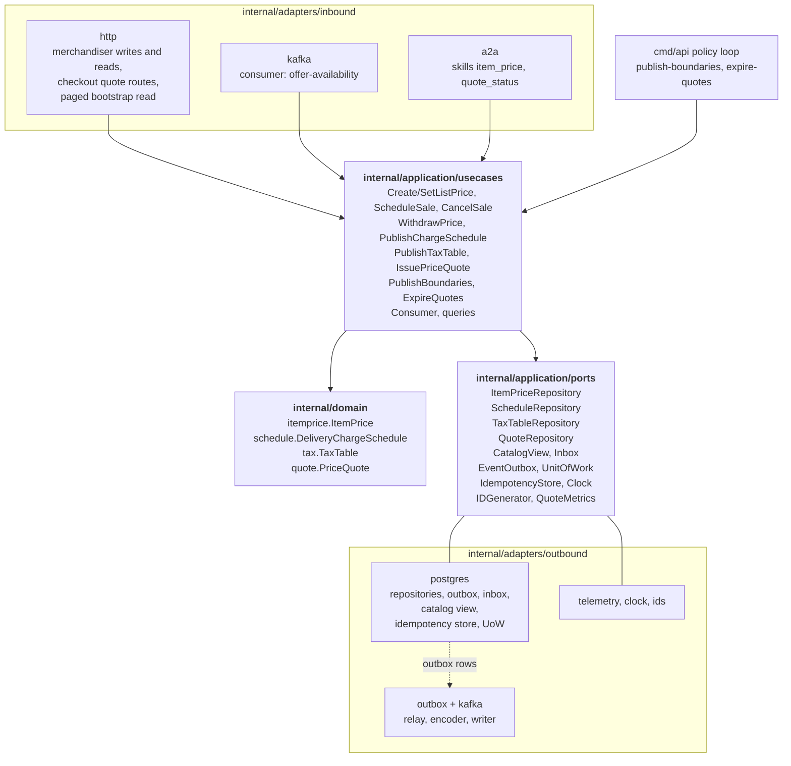

# Class Diagram

UML class diagrams of the `internal/domain/**` packages, plus the hexagonal
ports and adapters. Fields are unexported in Go and shown with `-`; methods
are shown with `+`. Exported types per package:

| Package | Exported types |
| --- | --- |
| `internal/domain/itemprice` | `ID`, `State`, `CatalogState`, `Inputs`, `SaleWindow`, `View`, `ItemPrice`, `Snapshot`, `ItemPriceChanged`, `ItemPriceWithdrawn` |
| `internal/domain/schedule` | `ID`, `State`, `TierCharge`, `DeliveryChargeSchedule`, `Snapshot`, `DeliveryChargeScheduleChanged` |
| `internal/domain/tax` | `ID`, `State`, `TaxBand`, `TaxTable`, `Snapshot`, `TaxTableChanged` |
| `internal/domain/quote` | `ID`, `State`, `LineInput`, `GroupInput`, `IssueInput`, `Line`, `Group`, `PriceQuote`, `Snapshot`, `PriceQuoteIssued` |
| `internal/domain/shared` | `Money`, `Tier`, `Event`, `Header`, the shared errors and the id helpers |

Terms are explained on [Ubiquitous language](/docs/ddd/ubiquitous-language) and
the invariants on the [Aggregate Design Canvas](/docs/ddd/aggregate-design-canvas).

## 1. ItemPrice aggregate

Source: `internal/domain/itemprice/itemprice.go`, `internal/application/ports/ports.go`.

`EffectivePrice` is derived, never stored: the lowest active sale price, else
the list price. Every command ends in `settle`, which bumps `version` and raises
`ItemPriceChanged` exactly when the published `View` differs from the last one.
`Save` is conditional on the loaded version (`LoadedVersion`, `MarkPersisted`).

## 2. DeliveryChargeSchedule and TaxTable aggregates

Source: `internal/domain/schedule/schedule.go`, `internal/domain/tax/tax.go`.

`Tier` is the network's delivery-promise vocabulary, re-declared locally in
`internal/domain/shared`: there is no shared kernel. Both aggregates share the
`CURRENT`/`SUPERSEDED` lifecycle: publishing a new version supersedes the
previous one in the same transaction (`PublishChargeSchedule`,
`PublishTaxTable`). `RateFor` returns 0 for a prefix no band covers.

## 3. PriceQuote aggregate and events

Source: `internal/domain/quote/quote.go`, `internal/domain/itemprice/events.go`,
`internal/domain/shared/shared.go`.

The three policies are use cases, not domain types: `PublishBoundaries`
(`PublishEffectivePriceOnWindowBoundary`) and `ExpireQuotes` (`QuoteTtl`) run
in the policy loop, `Consumer.CatalogItemDiscontinued` is `WithdrawOnDiscontinue`.
Issuing a quote publishes `PriceQuoteIssued`; expiry publishes nothing.

## 4. Hexagonal ports and adapters

Source: `cmd/api/main.go`, `cmd/api/policies.go`, `cmd/a2a/main.go`,
`internal/application/ports/ports.go`, `internal/architecture/architecture_test.go`.

There is no outbound REST client in this context. The read routes
(`GetItemPrice`, `ListItemPrices`, `GetCurrentChargeSchedule`,
`GetCurrentTaxTable`, `GetPriceQuote`) are query use cases over the same ports.
The A2A adapter holds `GetItemPrice` and `GetPriceQuote` only. The in-memory
adapters under `internal/adapters/outbound/memory` are test doubles that
`cmd/**` may not import.
