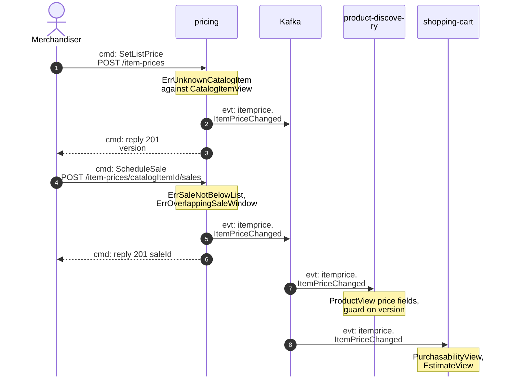
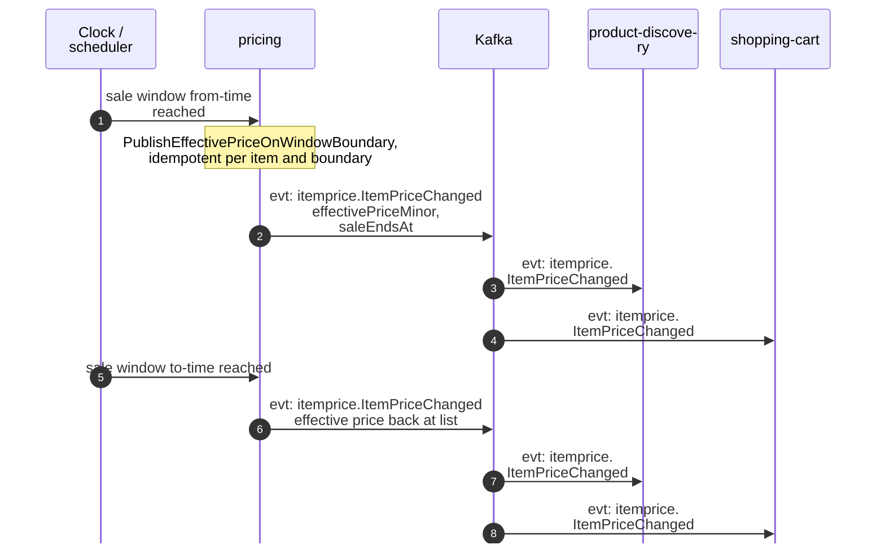
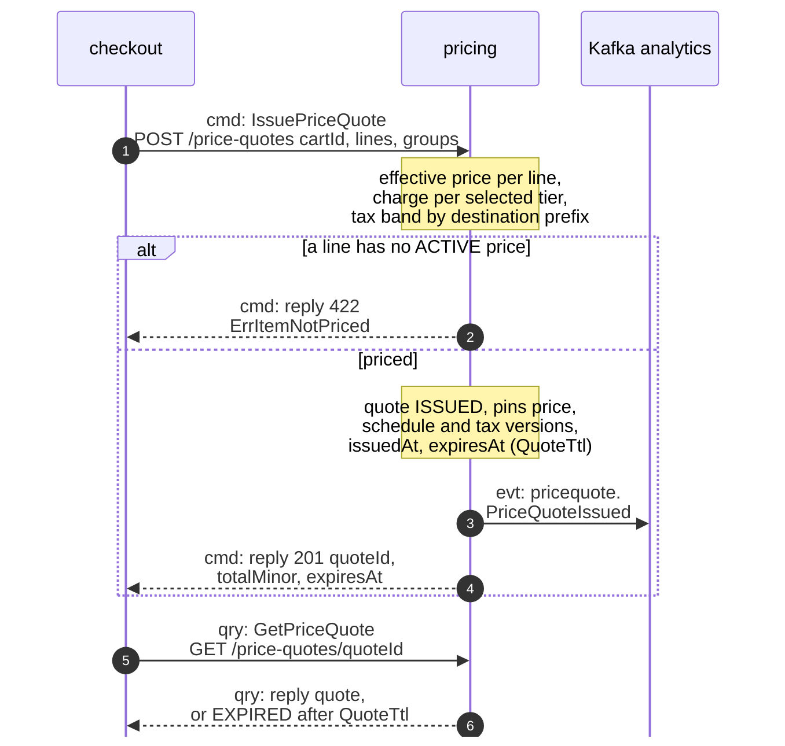
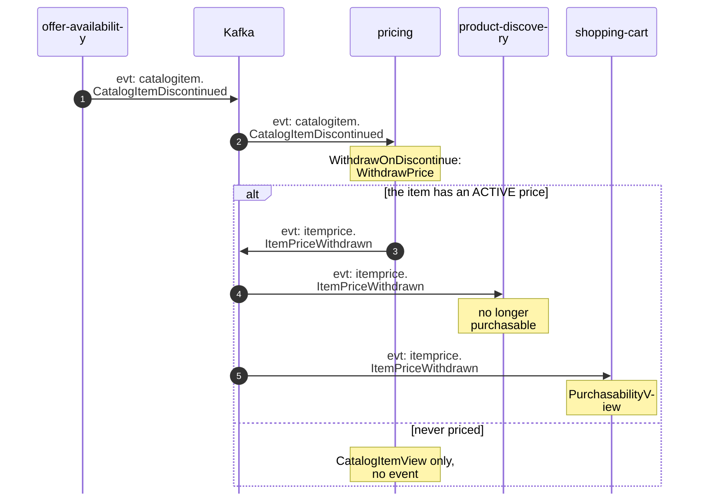

# Domain Message Flow

Following ddd-crew [Domain Message Flow Modelling](https://github.com/ddd-crew/domain-message-flow-modelling).
Four scenarios. Participants are contexts and actors. Every arrow is a
message from the model, prefixed `cmd:` (command), `qry:` (query) or `evt:`
(event). A `Note` names a command a context runs on itself. Kafka is drawn
as one participant. Event names are written `entity.EventName`; the full
type is `com.retailnetwork.<tier>.<producer>.<entity>.<EventName>` (see
[Domain Events](/docs/ddd/domain-events)). REST path
parameters are written without braces. The storefront-wide flows follow from
the [Context Map](https://iqvo.github.io/warehouse-docs/storefront/strategic-design/context-map).

## 1. Merchandiser prices an item and schedules a sale

Source: `internal/application/usecases/itemprice.go`, `internal/adapters/inbound/http/handlers.go`.

Derived from: `model.yaml → contexts[pricing].inbound` (merchandiser row),
`.aggregates[ItemPrice].commands` + `.invariants`,
`.publishes[ItemPriceChanged]`; `contexts[product-discovery].read_models`;
`contexts[shopping-cart].read_models`.

Omitted: the outbox write and relay (see
[Sequence Diagrams](/docs/ddd/sequence-diagrams)); the
`CancelSale` variant, which republishes `ItemPriceChanged` with the
effective price back at list (this pack's reading; the model names no
distinct event).

## 2. A sale window starts: the boundary policy republishes the price

Source: `cmd/api/policies.go`, `internal/application/usecases/consume.go` (`PublishBoundaries`).

Derived from: `model.yaml → contexts[pricing].policies[PublishEffectivePriceOnWindowBoundary]`,
`.aggregates[ItemPrice].value_objects` (`SaleWindow`), `.publishes`.

Omitted: the batch scan that finds the windows reaching a boundary, and the
burst behaviour the throughput estimate warns about ("bursts on sale
boundaries"). No aggregate state changes at a boundary: the windows are
already stored; only the published effective price moves.

## 3. Checkout issues a binding price quote

Source: `internal/application/usecases/quote.go`, `internal/domain/quote/quote.go`.

Derived from: `model.yaml → contexts[pricing].inbound` (checkout rows),
`.aggregates[PriceQuote]` (`commands`, `invariants`, `description`),
`.policies[QuoteTtl]`, `.publishes[PriceQuoteIssued]`;
`contexts[checkout].sync_calls` (`IssuePriceQuote`), `.invariants`
(`ErrPriceQuoteExpired`).

Omitted: the request's field list (`cartId`, `lines`, `groups`,
`destinationPostalPrefix`); `ExpireQuote`
runs on the clock and publishes nothing, so `checkout` enforces the TTL at
confirm with `ErrPriceQuoteExpired` and its own `ExpireOnQuoteExpiry`
policy. A changed total between cart and confirm is visible before confirm
— gap S2's answer.

## 4. The network discontinues an item

Source: `internal/adapters/inbound/kafka/offer_availability.go`, `internal/application/usecases/consume.go`.

Derived from: `model.yaml → contexts[pricing].consumes`,
`.policies[WithdrawOnDiscontinue]`, `.publishes[ItemPriceWithdrawn]`,
`.read_models[CatalogItemView]`; `network/model/model.yaml →
contexts[offer-availability].publishes[CatalogItemDiscontinued]`.

Omitted: `CatalogItemCreated`, which feeds only the view; the inbox; and
`product-discovery`'s independent consumption of the same
`CatalogItemDiscontinued` (its own conformist edge to the network). Pricing
learns of discontinuation from the network, not from a sibling storefront
context.
