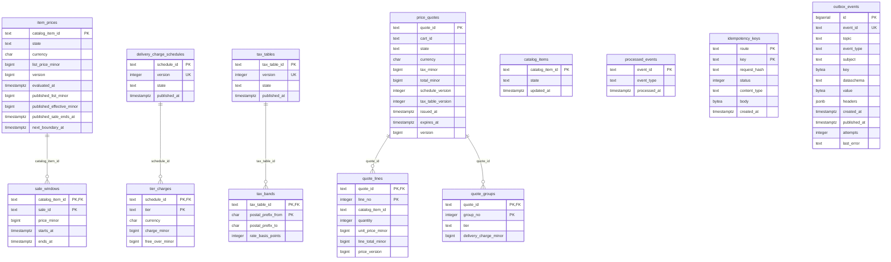

# Entity Relationship

The schema: [`0001_pricing_schema.up.sql`](https://github.com/IQVO/pricing/blob/develop/internal/adapters/outbound/postgres/migrations/0001_pricing_schema.up.sql), embedded in the binary and applied at boot with golang-migrate (which adds its own `schema_migrations` table). Pricing owns its database and shares no table with another context.

13 tables. Key markers: PK primary key, FK foreign key, UK unique. Types are the column types of the migration; constraints (CHECK, defaults, partial indexes) are in the file.

Source: `internal/adapters/outbound/postgres/migrations/0001_pricing_schema.up.sql`.

## Tables

| Table | Columns | Primary key | Role |
| --- | --- | --- | --- |
| `item_prices` | 10 | `catalog_item_id` | aggregate or read-model state |
| `sale_windows` | 5 | `catalog_item_id, sale_id` | aggregate or read-model state; FK to `item_prices` |
| `delivery_charge_schedules` | 4 | `schedule_id` | aggregate or read-model state |
| `tier_charges` | 5 | `schedule_id, tier` | aggregate or read-model state; FK to `delivery_charge_schedules` |
| `tax_tables` | 4 | `tax_table_id` | aggregate or read-model state |
| `tax_bands` | 4 | `tax_table_id, postal_prefix_from` | aggregate or read-model state; FK to `tax_tables` |
| `price_quotes` | 11 | `quote_id` | aggregate or read-model state |
| `quote_lines` | 7 | `quote_id, line_no` | aggregate or read-model state; FK to `price_quotes` |
| `quote_groups` | 4 | `quote_id, group_no` | aggregate or read-model state; FK to `price_quotes` |
| `catalog_items` | 3 | `catalog_item_id` | aggregate or read-model state |
| `processed_events` | 3 | `event_id` | inbox: one row per consumed CloudEvents id (dedupe) |
| `idempotency_keys` | 7 | `route, key` | stored REST answers per `Idempotency-Key`; the key is global, so `route` is always the empty string (kept to avoid a migration) and the row commits with the change and its outbox rows |
| `outbox_events` | 13 | `id` | transactional outbox the relay publishes to Kafka |
