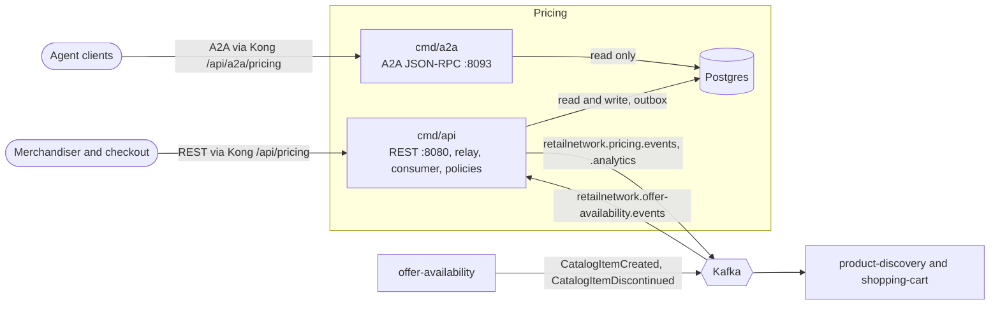

# Architecture

Pricing is a hexagonal service: dependencies point inward only. The layering is
enforced as an executable test (`TestHexagonalArchitecture`, arch-go, in
`internal/architecture/architecture_test.go`), not a convention.

## Layout

```text
cmd/api/                    composition root: REST API, outbox relay, the offer-availability
                            consumer and the clock-driven policy loop
cmd/a2a/                    composition root of the read-only A2A agent (ADR 0007)
internal/
  domain/                   pure business logic, imports nothing internal but shared
    itemprice/              ItemPrice aggregate, SaleWindow, ItemPriceChanged / Withdrawn
    schedule/               DeliveryChargeSchedule, TierCharge
    tax/                    TaxTable, TaxBand
    quote/                  PriceQuote, Issue arithmetic, PriceQuoteIssued
    shared/                 Money, Tier, Event, ids, shared errors
  application/
    ports/                  OUT interfaces only: repositories, CatalogView, Inbox,
                            EventOutbox, UnitOfWork, IdempotencyStore, Clock, IDGenerator, QuoteMetrics
    usecases/               one struct per use case (commands, queries, consumer, policies)
    idempotency/            the stored-response record and its 24 h TTL
    outbox/                 Message, Encoder, SendFailure
    views/                  read views returned by the use cases
  adapters/
    inbound/
      http/                 chi router, handlers, DTOs, problem mapping, Idempotency-Key, readiness
      kafka/                the offer-availability consumer, retry loop, dead letters, tracing
      a2a/                  Agent2Agent skills and Agent Card (read-only)
      requestlog/           access-log middleware
    outbound/
      postgres/             repositories, unit of work, inbox, outbox, embedded migrations
      kafka/                CloudEvents encoder, writer, relay sink, broker check
      outbox/               the relay loop
      telemetry/            OTel setup, quote metric, trace-correlated slog handler
      clock/ ids/           system clock and id generators
      memory/               in-memory test doubles (never imported by cmd/**)
      repocontract/         the repository contract suite shared by memory and Postgres
    kafka/cloudevents/      CloudEvents 1.0 envelope and decoder
  architecture/             fitness tests
  bootretry/                bounded retry of the first Postgres dial and the migrations
  bdd/                      godog wiring for features/
```

Rules that police it (see [Testing](/docs/development/testing#fitness-tests)):
the domain imports no outer layer; the use cases depend on ports, never on an
outbound adapter; `cmd/**` never imports the in-memory adapters; the A2A adapter
holds query use cases only; a `cmd/*` that builds an outbox relay must pass the
attempt cap.

Every command follows one shape inside **one unit of work**: load the
aggregate, call the domain, save it and append the events it raised to the
outbox, return a view. A version mismatch on save is `ErrConcurrentUpdate`;
`transact` re-runs the whole attempt (2 attempts for commands, 5 for consumed
events) before reporting a conflict.

## Binaries

| Binary | Role | Port | Probes | Needs |
| --- | --- | --- | --- | --- |
| `cmd/api` | REST API (`apis/openapi.yaml`), the outbox relay (`retailnetwork.pricing.events`, `retailnetwork.pricing.analytics`), the offer-availability consumer (`retailnetwork.offer-availability.events`) and the policy loop (`publish-boundaries`, `expire-quotes`) in one process | `HTTP_ADDR`, default `:8080` (Service port 80) | `/healthz` liveness, `/readyz` Postgres + Kafka | Postgres, Kafka |
| `cmd/a2a` | Read-only Agent2Agent JSON-RPC 2.0 on `/` and `/a2a`, Agent Card at `/.well-known/agent-card.json`; skills `item_price` and `quote_status` over the same query use cases as the REST `GET` routes | `A2A_ADDR`, default `:8093` | `/healthz` for liveness and readiness | Postgres only |

There is no `cmd/mcp`: this context has no MCP surface. The Dockerfile builds
every `cmd/*` into `/app` (`ENTRYPOINT ./api`; the chart starts the agent with
`/app/a2a`). Both binaries run the same embedded migrations at boot, wrapped in
a bounded retry (`internal/bootretry`).

Shutdown order in `cmd/api`: flip `/readyz` to 503, wait `SHUTDOWN_DRAIN_DELAY`,
drain HTTP (10 s), stop and await the consumer and the policy loop (10 s each),
stop and await the relay last so nothing committed above is stranded, then close
the pool. A worker that returns on its own makes the process exit non-zero.

## Container diagram



Source: `cmd/api/main.go`, `cmd/a2a/main.go`, `charts/pricing/templates/`
(`a2a-deployment.yaml`, `a2a-route.yaml`, `httproute.yaml`) and
`warehouse-infra` `helm-values/pricing.yaml` for the Kong paths.

The edge is Kong on `:8000`; the kind cluster routes `/api/pricing` to the api
Service and `/api/a2a/pricing` to the agent. Kafka is one broker platform-wide.

## Data stores

One Postgres database (role `pricing`, its own schema), created by the
embedded migration `0001_pricing_schema` in
`internal/adapters/outbound/postgres/migrations/`.

| Table | Holds |
| --- | --- |
| `item_prices`, `sale_windows` | The ItemPrice aggregate; `next_boundary_at` is indexed for the boundary scan |
| `delivery_charge_schedules`, `tier_charges` | Schedules (a partial unique index allows one `CURRENT`) and their per-tier charges |
| `tax_tables`, `tax_bands` | Tax tables (one `CURRENT`) and their postal-prefix bands |
| `price_quotes`, `quote_lines`, `quote_groups` | Quotes, with an index on `expires_at` for `ISSUED` rows |
| `catalog_items` | The local CatalogItemView (`ACTIVE` or `DISCONTINUED`) |
| `processed_events` | Inbox: the CloudEvents ids already applied |
| `idempotency_keys` | First response per route and key, 24 h |
| `outbox_events` | Encoded CloudEvents awaiting the relay, with `attempts` and `last_error` |

There is no cache, no search index and no second database. Kafka holds no
state of this context beyond the topics listed in the
[Runbook](/docs/operations/runbook#kafka).
